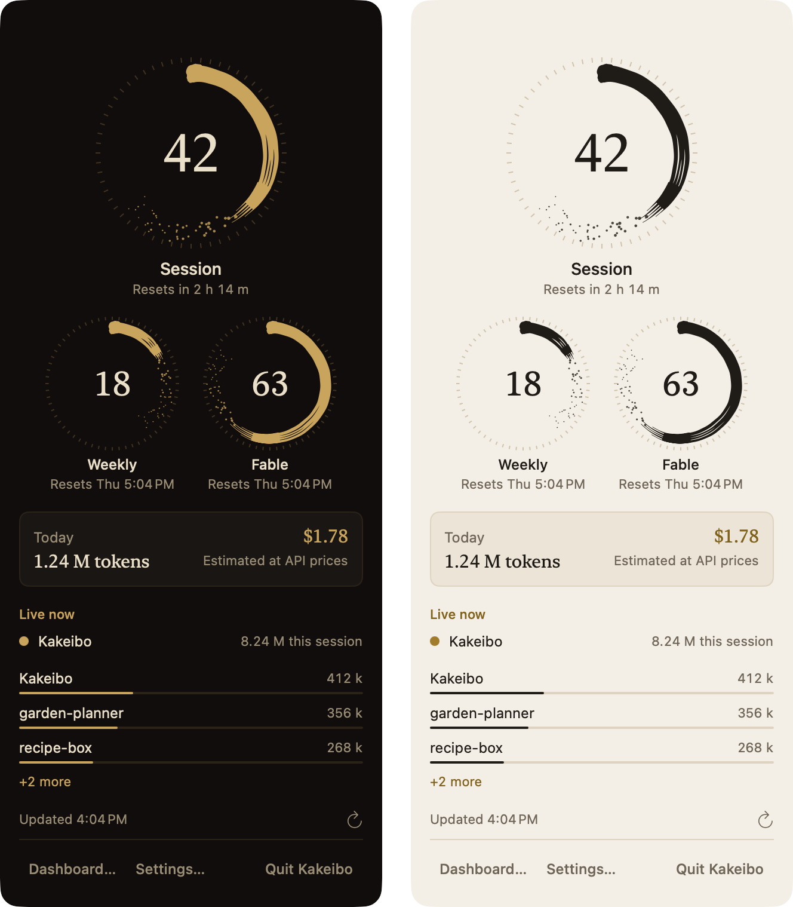
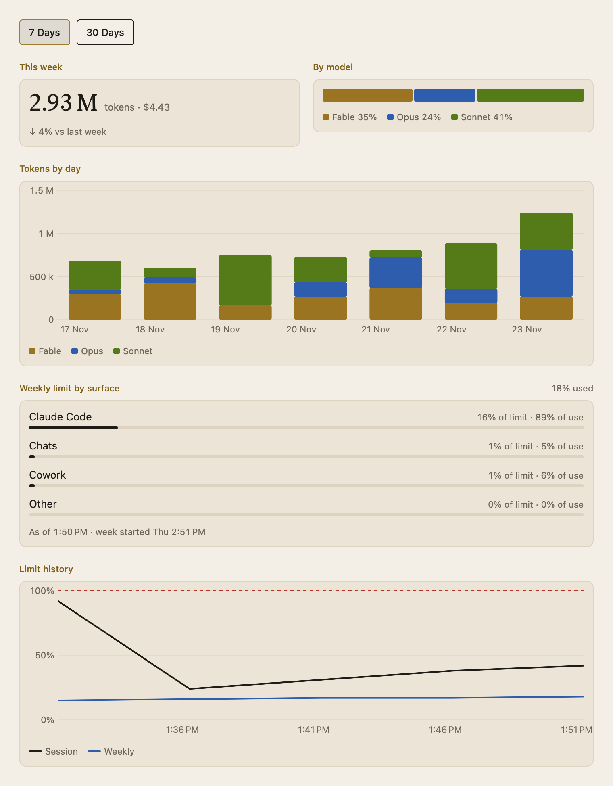
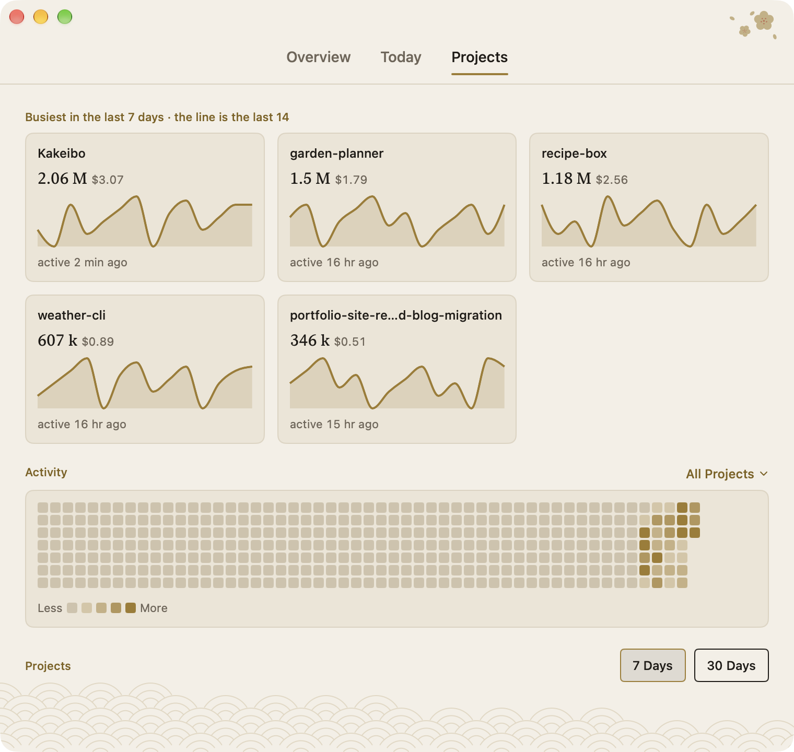
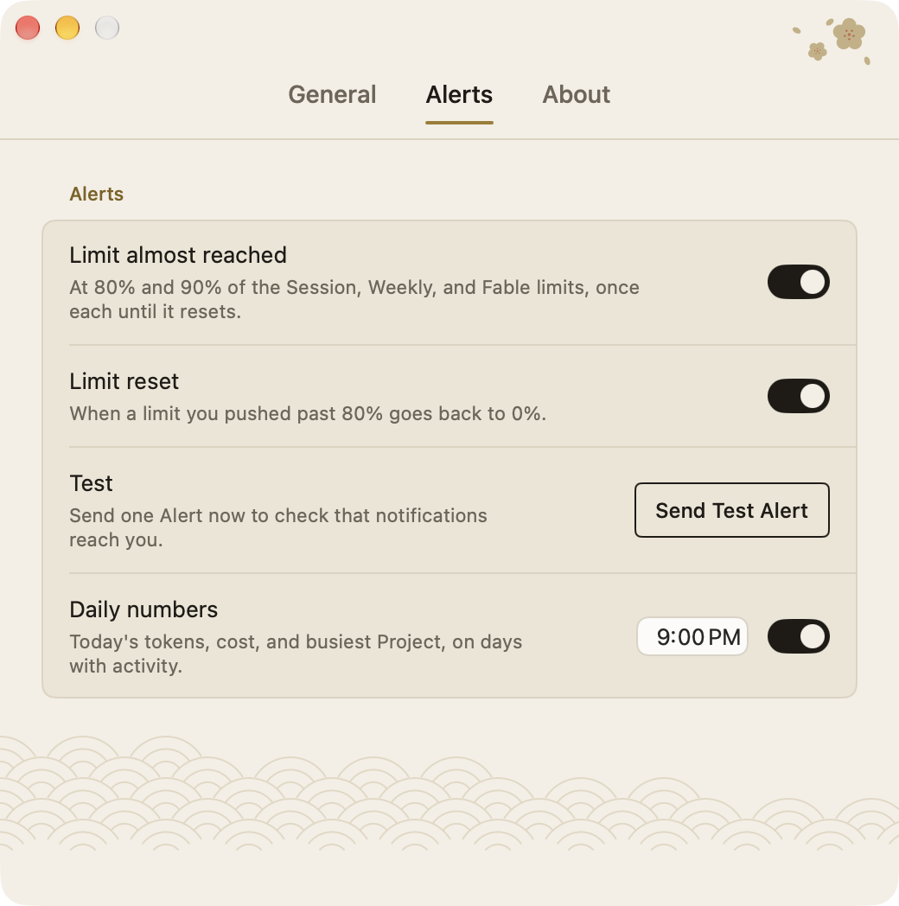

<p align="center">
  
</p>

<h1 align="center">Kakeibo</h1>

<p align="center">
  <strong>A ledger of your Claude usage, in the menu bar.</strong><br>
  Plan limits, tokens, cost, and projects. A native app for macOS 26.
</p>

<p align="center">
  <a href="https://github.com/hammadmo/kakeibo/releases/latest"></a>
  
  
  
  
</p>

<p align="center">
  
</p>

The name comes from *kakeibo* (家計簿), the Japanese household ledger: write down
what you spend, and you start to see where it goes. Kakeibo does that for Claude.
It shows how much of your Session, Weekly, and Fable limits you have used and when
each resets, and how many tokens each project used today, this week, and this month.

It is a sibling of [Hachibu](https://github.com/hammadmo/hachibu), and wears the
same lacquer-and-gold look.

## What it reads

- **Your plan limits**, from Anthropic, using the login Claude Code already keeps
  in your Keychain. Kakeibo reads that login and never stores or prints it.
- **Claude Code's own logs** in `~/.claude/projects`, read only, on your Mac.
  Tokens per reply, model, project, and time. Nothing from the logs leaves your Mac.

Cost is an estimate: the tokens priced at Anthropic's API prices. A Claude plan is not
billed per token, so read it as "what this work would cost on the API", not as a bill.

On the network Kakeibo does three things: it fetches your limits from Anthropic, it
checks GitHub once a day for a newer version (you can switch that off), and, only when
you press **Summarize**, it runs Claude Code with Haiku. There is no account and no server.

## Features

| Feature | What it does |
| --- | --- |
| **Menu bar** | An open brush ring for the Session limit, with its percentage. It turns vermilion at 90%. Choose Gauge Only, Session %, Session + Weekly, or Session + Fable. |
| **Popover** | Session, Weekly, and Fable gauges with when each resets, today's tokens and estimated cost, and the three busiest projects. |
| **Dashboard** | Tokens by day, stacked by model, for 7 or 30 days. This week against the same point last week. The split by model. The Weekly limit by surface (Claude Code, Chats, Cowork). Limit history. |
| **Projects** | A year of activity as a grid, for all projects or one, and every project's tokens, cost, and last activity, sortable. |
| **Summarize** | Two sentences from Claude (Haiku) about what you did in a project today. It reads only your own prompts, the names of changed files, and the day's git commits, and spends a few thousand tokens of your plan. |
| **Alerts** | At 80% and 90% of any limit, when a limit you pushed past 80% resets, and the day's numbers at a time you choose. Each can be switched off. |
| **`kakeibo` CLI and MCP** | Ask Kakeibo from Terminal, Claude Code, or any MCP client. See below. |
| **Updates** | Kakeibo checks for a newer version once a day and installs it when you agree. Every update is verified against Kakeibo's signing key first. |

## Screenshots

<p align="center">
  <picture>
    <source media="(prefers-color-scheme: dark)" srcset="docs/images/overview-full-dark.png">
    
  </picture>
</p>

<p align="center">
  <picture>
    <source media="(prefers-color-scheme: dark)" srcset="docs/images/projects-dark.png">
    
  </picture>
</p>

<p align="center">
  <picture>
    <source media="(prefers-color-scheme: dark)" srcset="docs/images/settings-alerts-dark.png">
    
  </picture>
</p>

The pictures show sample data, not a real account.

## Requirements

- An Apple silicon Mac running **macOS 26** or later.
- [Claude Code](https://code.claude.com), signed in (run `claude`, then `/login`). Kakeibo
  uses its login for your limits and its logs for your tokens.

## Install

1. Download `Kakeibo-0.1.zip` from the
   [0.1 release](https://github.com/hammadmo/kakeibo/releases/tag/v0.1) and unzip it.
2. Move `Kakeibo.app` to your Applications folder and open it. It lives in the
   menu bar; there is no Dock icon until you open the Dashboard or Settings.
3. The first time it fetches your limits, macOS asks whether Kakeibo may use the
   "Claude Code-credentials" Keychain item. Click **Always Allow**.
4. For Alerts, allow notifications when macOS asks (or in Settings > Alerts >
   Send Test Alert).

The download is signed with a Developer ID and notarized by Apple.

What changed in each version is in [CHANGELOG.md](CHANGELOG.md).

## The `kakeibo` command

The app binary is also a command line tool. Each command asks the running app,
so the numbers match what the menu bar shows. If Kakeibo is closed, the command
opens it in the background.

```bash
mkdir -p ~/.local/bin && ln -sf /Applications/Kakeibo.app/Contents/MacOS/Kakeibo ~/.local/bin/kakeibo
```

| Command | Answers |
| --- | --- |
| `kakeibo limits` | Session, Weekly, and Fable: used % and when each resets; the Weekly limit by surface |
| `kakeibo today` | Today's tokens and estimated cost, and the busiest projects |
| `kakeibo week` | This week against the same point last week |
| `kakeibo days --days 30` | Tokens and cost per day, split by model |
| `kakeibo projects --sort cost` | Every project's tokens, cost, and last activity |
| `kakeibo summary <project>` | Today's Summary of a project |
| `kakeibo summarize <project> --yes` | Make one with Haiku (spends plan tokens, so it needs `--yes`) |

Add `--json` for JSON, and run `kakeibo help` for every command and option.

### With Claude Code

Register the same commands as an MCP server, then ask in plain words ("how close am I
to my limits?"):

```bash
claude mcp add --scope user kakeibo -- /Applications/Kakeibo.app/Contents/MacOS/Kakeibo mcp
```

Claude Desktop and other MCP clients take the same command with the argument `mcp`.

### Check your download

The release notes give the zip's SHA-256. To check it, and to see who signed the
app and that Apple notarized it:

```bash
shasum -a 256 ~/Downloads/Kakeibo-0.1.zip
```

```bash
spctl -a -vv /Applications/Kakeibo.app
```

```bash
codesign -dv --verbose=2 /Applications/Kakeibo.app
```

`spctl` should say `accepted` and `source=Notarized Developer ID`, and `codesign`
should list `Authority=Developer ID Application: Mohamed Hammad`.

### Good to know

- The limits come from the endpoint Claude Code's `/usage` reads. Anthropic does not
  document it, so a change on their side can break it; Kakeibo then says it cannot
  reach your limits and keeps showing the last reading.
- If Kakeibo says "Sign in to Claude Code", the terminal `claude` is logged out
  (the desktop app keeps its own login). Run `claude`, then `/login`.
- Tokens count everything Claude Code logs: input, output, and cache writes and reads.
  Cache reads are most of it, so token totals look large next to the cost.

## Uninstall

1. In Settings > General, switch off **Open at Login**.
2. Quit Kakeibo and delete `Kakeibo.app` from your Applications folder.
3. To also remove its readings and Summaries, delete
   `~/Library/Application Support/Kakeibo` and run:

```bash
defaults delete app.kakeibo.mac
```

If you registered the MCP server: `claude mcp remove kakeibo`.

## Build from source

```bash
git clone https://github.com/hammadmo/kakeibo && cd kakeibo && ./build.sh --open
```

`build.sh` builds with Swift Package Manager, installs to `~/Applications`, and signs
with your own certificate if you have one. Releases: [docs/RELEASING.md](docs/RELEASING.md).
How it is put together: [ARCHITECTURE.md](ARCHITECTURE.md).

Designed and built by Mohamed Hammad.

## License

[MIT](LICENSE)
